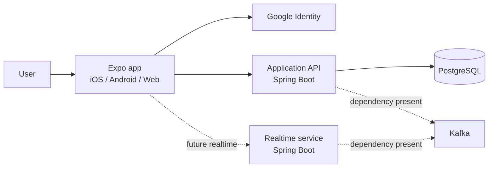
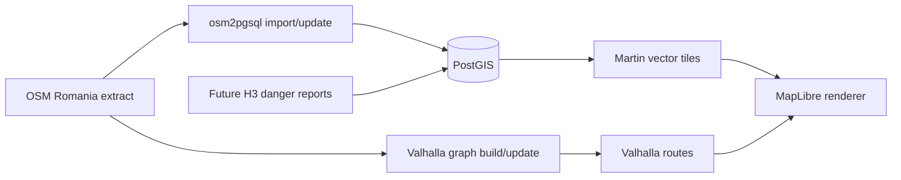

# WalkAround

WalkAround is a cross-platform Expo app backed by two independent Spring Boot services. The implemented product flow currently covers a public Romania map prototype using hosted vector tiles, Google-based account registration, sign-in, and session restoration.

## Architecture

WalkAround follows a microservices architecture: the client communicates with independently runnable backend services, each responsible for a distinct area of functionality. The current client is built with React Native/Expo and TypeScript; backend services use Spring Boot and Java. The intended data stack is PostgreSQL/PostGIS with Flyway-managed schema changes. The current Application API uses PostgreSQL and Flyway; PostGIS is not yet represented in its migrations. Valhalla is the planned routing engine, but it is not currently integrated.

- `frontend/` contains the Expo Router application and platform-specific session transports.
- `services/application-api/` owns registration, login, JWT validation, user lookup, and refresh-session persistence.
- `services/realtime-service/` is a separate Spring Boot service with WebSocket and Kafka dependencies. It currently has no message handlers or Kafka producers/consumers.
- `services/map-data/` owns the independent OSM import/update jobs, map PostGIS database, Flyway tile function, Martin tile/font serving, and map gateway. Its separate Compose project does not share the Application API database.
- `docker-compose.yaml` starts PostgreSQL and Kafka only. The frontend and Java services are run separately.

The frontend talks directly to the Application API. PostgreSQL stores user profiles, Google identities, and refresh-session hashes. Kafka and the Realtime service are infrastructure for future functionality; they are not currently part of the registration/login request path.

### Map Direction

The `/map` screen supports both hosted OpenFreeMap tiles and the self-hosted stack in [services/map-data/README.md](services/map-data/README.md). Hosted tiles remain the default until the regional import is verified and `EXPO_PUBLIC_MAP_STYLE_URL` is configured. Neither basemap requires Google sign-in or the Application API. See the [frontend guide](frontend/README.md#map-prototype) for setup and controls. The map architecture is:

The self-hosted basemap module includes a flex mapping, versioned tile query, matching style, local font serving, full-import commands, and regional replication-diff update jobs. Docker runtime validation and the Romania import are still required before deploying it; they were blocked by an unavailable Docker engine during implementation. The diagram's Valhalla and H3 branches remain future work. Valhalla builds its routing graph separately from OSM; PostGIS replication does not automatically update routes. Offline packs and terrain elevation are deferred to future stories.

## Product and Engineering Guardrails

- Start with map coverage for Romania to keep initial map data, storage, and memory requirements manageable.
- Design country coverage to be data-driven where practical, so adding neighboring countries is primarily a matter of supplying map/routing data rather than adding country-specific application logic. Revisit this assumption when selecting data sources and implementing routing.
- Use OpenStreetMap (OSM) as the primary source for map structure and features such as POIs, streets, and roads. Start with one regional PostGIS import via `osm2pgsql`, then apply matching regional replication diffs weekly rather than full reimports. Persist checkpoints, monitor lag, and include required OSM attribution.
- Use H3 cells to represent reported dangerous areas and their coverage instead of ad hoc circles. Select the cell resolution and aggregation rules to avoid misleading gaps or overly broad affected regions.
- Use Martin as the planned tile server to serve map tiles from the geospatial data store, and MapLibre GL in the client to render them. The tile server supplies viewport-specific data; MapLibre GL is the renderer, not the tile server. Avoid loading the entire regional map dataset into client memory.
- Valhalla is the planned routing engine. Model report severity so lower-risk areas can produce warnings while more serious areas influence route selection; validate the appropriate Valhalla costing or integration approach before defining the routing API. GraphHopper has also been suggested for its user-weighted hazard routing; revisit it only if the team decides to reconsider the current Valhalla choice.
- Discuss complex features and cross-service changes with the team before implementation.

## Local Development

Prerequisites: Node.js/npm, Java 25, and Docker Compose. Google OAuth credentials and application configuration are needed for end-to-end authentication.

1. Copy `.env.example` to `.env` and replace its placeholders. Create the database and Kafka env files referenced by `APPLICATION_API_DB_ENV_FILE_LOCATION` and `KAFKA_ENV_FILE_LOCATION`.
2. Start local infrastructure with `docker compose up -d` from the repository root.
3. Configure and run the Application API as described in [services/application-api/README.md](services/application-api/README.md).
4. Configure and run the app as described in [frontend/README.md](frontend/README.md).

The root `.env.example` contains placeholders rather than ready-to-run values. Frontend configuration is separate and uses `EXPO_PUBLIC_API_BASE_URL`, `EXPO_PUBLIC_GOOGLE_WEB_CLIENT_ID`, and `EXPO_PUBLIC_GOOGLE_IOS_CLIENT_ID`.

## Documentation

- [Frontend](frontend/README.md)
- [Application API](services/application-api/README.md)
- [Realtime service](services/realtime-service/README.md)
- [Map data and self-hosted tiles](services/map-data/README.md)