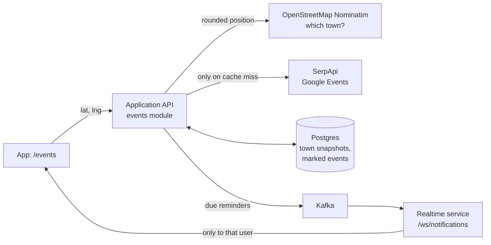

# Upcoming events backend (SCRUM-35)

This feature lists upcoming events in the town the user is in, lets signed-in users mark events they are interested in, and sends in-app reminders before marked events. All endpoints require a signed-in user.

## In short

- **Which events?** The backend finds the town that contains the user's position and shows the events Google Events lists for that town. There is no radius search: the provider only works per town.
- **When is the provider called?** Only when the town's list is not cached or is older than 24 hours. Lists are kept in memory and in the database, so restarts and repeat visits cost nothing.
- **What is stored?** One cached list per town (as JSON), a per-event cache of extra details (`event_details_cache`) so repeat views cost no provider searches, and the events users mark (`event_interests`).
- **Terms used below:** a *locality* is the town, city or commune from OpenStreetMap; its *locality key* looks like `RO/cluj/cluj-napoca`. An *event key* is a stable ID the backend computes for each event (see [Event keys and dates](#event-keys-and-dates)).

## Where to start

| Concern | Package / class | Main responsibility |
| --- | --- | --- |
| HTTP endpoints | [`controllers/EventsController`](controllers/EventsController.java) | Nearby list, event details, marking, reminders. Errors are mapped in `controllers/exceptionhandlers`. |
| Town lookup | [`service/locality`](service/locality) | Turn coordinates into the containing city, town or commune with OpenStreetMap Nominatim. |
| Event sources | [`service/source`](service/source) | `SerpApiEventSource` (live Google Events) or `RecordedEventSource` (saved responses, no API calls). |
| Cleaning results | `service/EventListBuilder`, `service/EventDateParser` | Parse dates, infer the missing year, drop past events and duplicates, sort by start time. |
| Caching | `service/EventsService` | Memory cache, then a per-town database snapshot, then the event source. |
| Event details | `service/EventDetailsService`, `service/EventDetailsEnrichmentService` | Merge cached list data, user interest and cached on-demand provider details into a presentation-ready DTO. |
| Marked events | `service/EventInterestService` | Save a snapshot of a marked event and its reminder setting. |
| Reminders | [`service/reminders`](service/reminders) | Every minute, publish due reminders to Kafka for the realtime service. |
| Settings | [`configurations`](configurations) | `app.events.*` properties, HTTP clients with timeouts, scheduling. |

## Endpoints

| Method and path | Purpose |
| --- | --- |
| `GET /api/events/nearby?lat=&lng=` | Events for the town containing the position. `locality` is null when the position is not in any town; `stale` is true when an older cached list is served because the source failed. |
| `GET /api/events/details?localityKey=&eventKey=` | One merged event (`EventDetailsDto`), the signed-in user's reminder state (`interest`, or `null`), the `enrichment` status (`COMPLETE`, `BASIC`, or `UNAVAILABLE`), and `attribution`. |
| `GET /api/events/interests` | The user's marked events that have not passed. |
| `PUT /api/events/interests` | Body `{ localityKey, eventKey, remindBeforeMinutes }`. Marks an event, or changes its reminder. `remindBeforeMinutes` is `null` for no reminder, otherwise 1 to 43200 (30 days). |
| `DELETE /api/events/interests/{eventKey}` | Removes a marked event. |
| `GET /api/events/reminders/unseen` | Reminders already sent but not yet dismissed, for users who were offline. |
| `POST /api/events/interests/{eventKey}/reminder-seen` | Records that the user dismissed or opened a reminder. |

## How a nearby request works

1. The position is rounded to two decimals (about 1 km) and reverse-geocoded with Nominatim. The result is cached in memory.
2. The town's event list is taken from memory if it is younger than `EVENTS_CACHE_TTL` (24 hours by default).
3. Otherwise the `event_locality_snapshots` row for the town is used if it is fresh. This survives restarts.
4. Otherwise the event source is called. For SerpApi this is two searches: `"Events in <town>, <county>"` and `"Events"` with the town as the search location. Testing showed these two wordings return different events, while paging (`start`) and date filters (`htichips`) returned the same results, so no further searches are made. Results are merged, cleaned, saved to the snapshot and returned.
5. If the source fails and an older snapshot exists, it is served with `stale: true`.

Whatever the provider returns for the town is shown. Google widens searches for small towns, so a town such as Florești returns Cluj-Napoca events; each event keeps its real address. Positions outside any town, or towns without results, get an empty list.

Concurrent requests for the same town share one fetch. Past events are also filtered when cached lists are read, so a list fetched in the morning hides events that ended later that day.

## Event keys and dates

The provider has no stable event IDs. An event key is the first 32 hex characters of a SHA-256 of the accent-free title, local start day and venue. The same event from both searches therefore gets the same key, and keys stay stable between refreshes.

List results have dates like `Nov 6, 8:00 PM` or `Feb 11` without a year. The next occurrence of that day (today included) is assumed, because the provider lists only upcoming events. Dates without a time are treated as all-day events. Times are interpreted in `EVENTS_TIME_ZONE` (`Europe/Bucharest`).

## Event details

`GET /api/events/details` merges data with precedence **provider details → cached locality list → user's saved interest snapshot**.

1. When an event is opened and extra details are not yet in `event_details_cache` (or have expired), `EventDetailsEnrichmentService` calls the provider once (single-flight per `eventKey`) and caches the result for `EVENTS_DETAILS_CACHE_TTL` (7 days by default).
2. Because `eventKey` is stable across daily list refreshes, repeat views of the same event cost **0** provider searches.
3. Failed or empty lookups are negative-cached for `EVENTS_DETAILS_FAILURE_TTL` (1 hour by default), and failures degrade gracefully (`enrichment: UNAVAILABLE`) while still serving the cached list or interest data.

## Marked events

`event_interests` stores a copy of the event (title, start, venue, address, description, image, first ticket link), so the Interested list and reminders work without calling the provider again.

When an event is marked, `EventInterestService` reuses `EventDetailsEnrichmentService`, so marking an event the user has already opened costs **0** extra searches. If the details request fails, or the provider has no details fixture, the cached list data is saved instead.

## Reminders

`EventReminderJob` runs every minute. It finds interests whose `remind_at` has passed, the event has not started and `reminded_at` is empty. It publishes each one to Kafka (`EVENTS_REMINDER_TOPIC`, default `event-reminders-topic`) with the user id as the key, then sets `reminded_at` so it is sent once. A reminder that cannot be published stays due and is retried on the next run. A reminder whose time has already passed when it is set fires on the next run.

The realtime service delivers the message only to that user's open `/ws/notifications` connections. See the [realtime service README](../../../../../../../realtime-service/README.md).

## Configuration

| Variable | Default | Meaning |
| --- | --- | --- |
| `EVENTS_PROVIDER` | `serpapi` | `serpapi` for live data, `recorded` to replay the responses in `src/main/resources/events/recorded/` (Cluj-Napoca, Bucharest, Brașov, Florești; recorded 2026-11-05). Use `recorded` for development and tests. |
| `EVENTS_SERP_API_KEY` | empty | The events feature's own SerpApi key, separate from `SERP_API_KEY` used by trip planning. The app starts without it; requests then return 503. |
| `EVENTS_CACHE_TTL` | `PT24H` | How long a town's list is reused before fetching again. |
| `EVENTS_TIME_ZONE` | `Europe/Bucharest` | Zone for the provider's local event times. |
| `EVENTS_NOMINATIM_USER_AGENT` | `WalkAround-university-project/1.0 (upcoming events)` | Identifies the app to Nominatim, as its usage policy requires. |
| `EVENTS_REMINDERS_ENABLED` | `true` | Turns the reminder job on or off. |
| `EVENTS_REMINDER_TOPIC` | `event-reminders-topic` | Kafka topic shared with the realtime service. |
| `EVENTS_DETAILS_ENABLED` | `true` | Turns on-demand provider enrichment for event details on or off. |
| `EVENTS_DETAILS_CACHE_TTL` | `P7D` | How long successful provider event details are cached in `event_details_cache`. |
| `EVENTS_DETAILS_FAILURE_TTL` | `PT1H` | Negative-cache duration after a failed or empty details lookup. |
| `EVENTS_DETAILS_TIMEOUT` | `PT8S` | Read timeout for on-demand event details calls. |

## Usage limits and attribution

- SerpApi's free plan allows 250 searches a month. A town costs two searches per cache period, and marking an event costs one. The `recorded` provider uses none.
- The public Nominatim service allows at most one request per second for the whole app, requires caching and an identifying User-Agent, and must not receive exact personal positions. `NominatimLocalityResolver` serializes calls, caches results and sends rounded coordinates. See the [Nominatim usage policy](https://operations.osmfoundation.org/policies/nominatim/).
- Responses include an attribution line for Google Events via SerpApi and OpenStreetMap; the app shows it under the list.

## Try it locally

1. Start Postgres and Kafka from the repository root: `docker compose up -d application-api-db kafka`.
2. In `services/application-api/.env` set `EVENTS_PROVIDER=recorded`. No SerpApi key is needed in this mode.
3. In `services/realtime-service/.env` set the same `JWT_SIGNING_SECRET`, `JWT_ISSUER` and `JWT_AUDIENCE` as the Application API.
4. Start the Application API and the realtime service with their `.env` values loaded (Spring Boot does not read `.env` files by itself; use your IDE's run configuration or export the variables first), then the frontend with `npm run web`.
5. Sign in, open the map's **Upcoming events** menu item, or go straight to `http://localhost:8081/events?lat=46.7712&lng=23.5899`. The `lat`/`lng` parameters are used when the browser does not share its location; these coordinates are in Cluj-Napoca, which has recorded data.
6. Mark an event that starts within a week and choose **1 week before**. That time has already passed, so the reminder banner appears within about a minute.

To use live data, set `EVENTS_PROVIDER=serpapi` and `EVENTS_SERP_API_KEY` to your own key. Each new town costs two searches; marking an event costs one.

## Troubleshooting

| Symptom | Likely cause |
| --- | --- |
| `503 Events are temporarily unavailable` | `EVENTS_PROVIDER=serpapi` without `EVENTS_SERP_API_KEY`, an exhausted SerpApi quota, or Nominatim unreachable. Use `recorded` for development. |
| Empty list in `recorded` mode | Only Cluj-Napoca, Bucharest, Brașov and Florești have recordings; other towns return no events. |
| Old events missing from a recording | Past events are hidden. The recordings date from 2026-11-05, so they empty out over time; record new ones or use live mode. |
| No reminder banner | The realtime service is not running, `EXPO_PUBLIC_WS_URL` is not set in the frontend, or its `JWT_*` values differ from the Application API's, so the connection is rejected with 401. |
| `404 This event is no longer available` when marking | The town's cached list no longer contains the event, for example after a refresh. Reload the list. |

## Tests

| Test | What it checks |
| --- | --- |
| `EventDateParserTest` | List and details date formats, missing years, time ranges, invalid dates. |
| `EventListBuilderTest` | De-duplication across the two searches, past-event filtering, sorting, stable event keys. |
| `EventsServiceTest` | Memory cache, database snapshot after a restart, refresh after the TTL, stale fallback, no locality. |
| `EventInterestReminderTest` | Reminder times, immediate reminders, clearing and changing reminders. |
| `RecordedEventSourceTest` | The recorded responses load and clean up as expected. |
| `EventsFlowIntegrationTest` | The whole HTTP flow against a real Postgres (Testcontainers): nearby list, marking, reminders sent once, unseen and seen reminders, unmarking, sign-in required. Needs Docker; skipped without it. |

The unit tests need no Docker, and no test makes real SerpApi or Nominatim calls.
