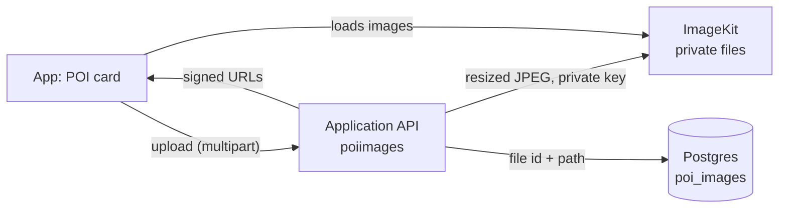

# POI photos backend (SCRUM-42)

Signed-in users can attach photos to points of interest (POIs) on the map, see the photos others added, and delete their own. All endpoints require sign-in, including viewing.

## In short

- **What is a POI here?** A place shown in the self-hosted map's `pois` tile layer. Each has a `poi_id`: a curated POI's UUID, or an OpenStreetMap reference such as `osm:n/123456` (`n` node, `w` way, `r` relation). Photos are attached to that id. The API also accepts `osm:node/…`, `osm:way/…`, `osm:relation/…` and upper-case UUIDs, but always stores the map's form, so a place never ends up with two photo lists.
- **Where are the image files?** In **ImageKit** (imagekit.io), following the same approach as group chat images but with its own, separate code, settings and HTTP client. By default it uses the project's ImageKit account (`IMAGEKIT_*`). Files are uploaded as **private** files to `/walkaround/poi-images/<poi folder>/<photo id>.jpg`, a folder no other feature uses.
- **What is in our database?** Only a small text row per photo in `poi_images` (migration V18): POI id, uploader, caption, size, and the ImageKit file id and path. No image bytes.
- **What happens to an upload?** The file must really be a JPEG or PNG (its contents are checked, not its name). It is turned upright using its EXIF orientation tag (phones often store pixels sideways and rely on that tag), resized to at most 1600 px on the longest side, and re-encoded as JPEG, which removes all photo metadata, including the GPS position phones store in pictures. Only then is it sent to ImageKit.
- **How are photos shown?** Each list response contains **signed ImageKit URLs** that expire after `POI_IMAGEKIT_SIGNED_URL_TTL` (1 hour by default, rounded up to 10 minutes). The app loads the images straight from ImageKit. Thumbnails are made by ImageKit on request (`tr:w-320,c-at_max`: resize down to 320 px wide, never enlarge), so only one file is stored per photo.

## Where to start

| Concern | Class | Responsibility |
| --- | --- | --- |
| HTTP endpoints | `controllers/PoiImagesController` | List, upload, delete. Errors are mapped in `PoiImagesExceptionHandler`. |
| Rules | `service/PoiImageService` | POI id and caption validation, per-user limit, ownership check, upload-then-save order with cleanup. |
| Image handling | `service/PoiImageProcessor`, `service/ExifOrientation` | Format check, pixel limit, upright rotation from the EXIF orientation tag, resize, JPEG re-encoding. |
| File storage | `service/ImageKitPoiImageStorage` (behind `PoiImageStorage`) | Upload, signed URLs, delete, with its own `poiImageKitRestClient`. |
| Metadata | `model/PoiImage`, `repository/PoiImageRepository` | One row per photo with the ImageKit reference. |
| Settings | `configurations/PoiImagesProperties`, `configurations/PoiImageKitProperties` | `app.poi-images.*` limits and `app.poi-images.imagekit.*` ImageKit settings. |

## Endpoints

The POI id is a query parameter because OpenStreetMap ids contain a `/`.

| Method and path | Purpose |
| --- | --- |
| `GET /api/poi-images?poiId=…` | Photos of a POI, newest first: id, caption, size, who added it, whether it is `mine`, and signed `imageUrl` / `thumbnailUrl`. |
| `POST /api/poi-images?poiId=…` | Multipart upload: part `file` (JPEG or PNG) and optional part `caption` (up to 200 characters). Returns `201` with the new photo. |
| `DELETE /api/poi-images/{id}` | Deletes the photo and its ImageKit file. Only the user who added it may do this (`403` otherwise). |

Signed URLs stop working after they expire; listing the photos again returns fresh ones. The expiry is rounded up to a 10-minute step, so the same photo keeps the same URL for a while and browsers can reuse cached images (a URL therefore works for between 1 hour and 1 hour 10 minutes). Anyone holding a signed URL can view that photo until it expires, so the URLs should not be logged or shared.

## Upload and delete order

- **Upload:** the photo is validated and processed, uploaded to ImageKit, and only then recorded in the database in a short transaction, so a slow upload does not hold a database connection. If recording fails, the uploaded file is deleted from ImageKit again; once the row is committed, the file is never removed by the upload request. ImageKit's answer is checked (file id, expected path, file type); an unexpected answer is treated as a failure and the file is removed.
- **Delete:** the database row is deleted first (after the ownership check), then the ImageKit file. If ImageKit cannot be reached, the failure is logged and the photo is already gone from the app; the leftover file can be found by its photo id in the POI's folder.
- If the server stops between uploading and recording, a file can remain in ImageKit without a row; its file name is the photo id, which never appears in `poi_images`.

## Errors

| Status | When |
| --- | --- |
| `400` | Invalid POI id, caption over 200 characters, missing file, or a file that is not a JPEG or PNG, or has too many pixels. |
| `401` | Not signed in. |
| `403` | Deleting someone else's photo. |
| `404` | The photo does not exist (any more). |
| `409` | The user already added the maximum number of photos to this POI. |
| `413` | The file is larger than the upload limit. |
| `503` | ImageKit is not configured on this server, or did not respond as expected. |

## Configuration

POI photos have their own ImageKit settings (`app.poi-images.imagekit`) and do not use any other feature's code. By default each setting reads the project's shared `IMAGEKIT_*` variable, so the same ImageKit account works without extra configuration; a `POI_IMAGEKIT_*` variable overrides it for POI photos only:

| Variable | Falls back to | Meaning |
| --- | --- | --- |
| `POI_IMAGEKIT_URL_ENDPOINT` | `IMAGEKIT_URL_ENDPOINT` | Your ImageKit URL endpoint, for example `https://ik.imagekit.io/<your id>`, from the ImageKit dashboard (Developer options). |
| `POI_IMAGEKIT_PRIVATE_KEY` | `IMAGEKIT_PRIVATE_KEY` | A private API key (starts with `private_`) with permission to upload and delete files. Keep it only in the local `services/application-api/.env`; it never reaches the app. |
| `POI_IMAGEKIT_UPLOAD_URL` | `IMAGEKIT_UPLOAD_URL` | ImageKit's upload API (default `https://upload.imagekit.io/api/v1/files/upload`). |
| `POI_IMAGEKIT_FILES_URL` | `IMAGEKIT_FILES_URL` | ImageKit's file management API, used to delete files (default `https://api.imagekit.io/v1/files`). |
| `POI_IMAGEKIT_TIMEOUT` | — | Timeout for ImageKit calls (default `PT10S`). |
| `POI_IMAGEKIT_SIGNED_URL_TTL` | — | Minimum lifetime of signed photo URLs (default `PT1H`). |

Without an ImageKit endpoint and private key the rest of the app works, but listing and uploading photos return `503`.

| Variable | Default | Meaning |
| --- | --- | --- |
| `POI_IMAGE_MAX_BYTES` | `5242880` (5 MB) | Largest accepted upload. Must not exceed `PROFILE_PICTURE_MAX_BYTES`, which also sets the server's global multipart upload limit. The app checks the same limit before uploading. |
| `POI_IMAGE_MAX_PIXELS` | `25000000` | Largest decoded image (width × height). Checked before decoding to bound memory use. |
| `POI_IMAGE_OUTPUT_SIZE` | `1600` | Longest side of the stored photo. |
| `POI_IMAGE_THUMBNAIL_SIZE` | `320` | Thumbnail width, produced by ImageKit on request (never enlarged). |
| `POI_IMAGE_MAX_PER_USER_PER_POI` | `10` | Photos one user may add to one POI. |

ImageKit's free plan includes 3 GB of storage and 20 GB of delivery per month ([plans](https://imagekit.io/plans/)). When POI photos use the same account as group chat images, those limits are shared.

## Not included

- No moderation beyond uploaders deleting their own photos; the app has no admin roles.
- Photos are only offered for POIs from the self-hosted map. The default hosted OpenFreeMap map has no POI ids, so the photo section does not appear there, nor for search results or tapped coordinates.
- If a POI disappears from the map data in a later import, its photos stay in ImageKit and the database but are no longer reachable from the map.

## Tests

| Test | What it checks |
| --- | --- |
| `PoiImageProcessorTest` | Resizing, PNG to JPEG, upright rotation (size and pixels), removal of EXIF/GPS metadata, rejected formats, size and pixel limits. |
| `ExifOrientationTest` | Reading the orientation tag in both byte orders; missing, invalid or truncated data counts as upright. |
| `ImageKitPoiImageStorageTest` | Signed photo and thumbnail URLs (independently recomputed HMAC), expiry rounding, refusal to sign other folders, the private upload request, cleanup on unexpected answers, delete, missing configuration. No real ImageKit calls. |
| `PoiImageServiceValidationTest` | Accepted and rejected POI ids, normalisation to the map's id form, caption trimming and length. |
| `PoiImagesFlowIntegrationTest` | The HTTP flow against a real Postgres (Testcontainers) with a fake ImageKit: sign-in required, upload, list, owner-only delete including the ImageKit file, per-user limit, long and short OSM ids sharing one list, nothing saved when ImageKit fails, invalid requests, and no image bytes in the table. Needs Docker; skipped without it. |

The frontend tests (`frontend/tests/poiImages.test.mjs`) also check that the app's upload and caption limits match this configuration and the database column.

## Known limits

- The limit is per user and per POI; there is no overall per-user quota, and ImageKit's free storage is shared with group chat images.
- Photos can be attached to any well-formed POI id, including one that is not on the map; POIs are not looked up in the map database.
- A card left open longer than the URL lifetime shows placeholders until it is reopened.
