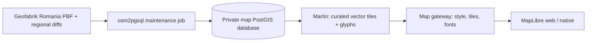

# Map Data

Independent OSM basemap infrastructure: a dedicated PostGIS database, an osm2pgsql import/update job, Flyway-managed tile functions, and read-only Martin serving. This stack does not connect to the Application API database, Kafka, or the realtime service. Valhalla, H3 reports, offline downloads, and elevation are outside its scope.

## Architecture and Ownership



- The root `docker-compose.yaml` includes this module's `compose.yaml`. Map paths and interpolation defaults come from `services/map-data/`, while all normal services share the root Compose project. The map database remains separate from the Application API database.
- `importer/flex.lua` owns the OSM-to-feature mapping; `osm.features` stores selected display geometry in Web Mercator (EPSG:3857). Osm2pgsql maintains object identities and the separate `osm_middle` state needed for updates. Do not remove the middle tables or use `--drop`.
- `database/migrations/` contains this module's Flyway migrations, not the Application API's migrations. Apply future SQL changes with new versions. Initial extension/role setup runs once on a fresh database volume.
- `tiles.basemap(z, x, y)` produces an MVT layer named `features`, with `kind`, `class`, optional `name`, and POI `point_count` attributes. Geometry indexes and zoom filtering limit each query to the tile envelope. MVT extent is 4096 with a 64-unit buffer for base features to avoid clipped strokes at tile edges.
- `map_import` owns imports/migrations; `map_tiles` has read-only feature access and execution permission on the published function, not access to raw replication state. The database is published on `127.0.0.1:${MAP_DB_HOST_PORT:-5435}` for local administration; Martin is not published. The gateway is bound to loopback by default.
- `gateway/style.json` matches this small schema; it is not OpenMapTiles-compatible. Noto Sans glyphs are generated by Martin from a font packaged into its image. No external tile/font provider or sprites are needed for this style.

This is a first self-hosted basemap implementation, not a production-tuned replacement for a mature global map style. It includes roads, inland water, waterways, land cover, building footprints, place/road/POI labels, administrative boundary lines, and coastline lines. Sea polygon generation, rail/transit styling, detailed bridge/tunnel ordering, and pre-generalized low-zoom layers are not included. Coastline lines alone do not fill the Black Sea; that needs a processed coastline polygon dataset or a separate coastline-build step. Geometry selection uses display-oriented zoom thresholds, not a comprehensive mapping of every OSM tag.

## POI Source Strategy and Model

The POI foundation is separate from the osm2pgsql-owned basemap. V3 defines source/provenance tables, V4 adds explicit record reconciliation and review, and V5 publishes a separate POI tile layer. These migrations do not fetch external APIs or populate a real enriched dataset. Future enrichment jobs must be explicitly triggered by an operator and run infrequently. There is no POI scheduler, cron task, automatic polling, or enrichment/reconciliation step in `setup`/`start`.

### Initial Sources

| Source | Intended contribution | Licensing and usage guardrail |
| --- | --- | --- |
| OpenStreetMap | Baseline amenities, shops, tourism facilities, and useful walking stops from the existing regional extract | ODbL 1.0; preserve attribution and assess derived-database obligations before combination/distribution. Reuse the extract rather than bulk-querying the public editing API. |
| Wikidata | First external API candidate for stable identifiers, multilingual labels, and notable cultural/tourism places | Structured entity data is CC0. Non-structured pages and linked media have different terms. Confirm API usage policy and bound requests before implementing an adapter. |
| GeoNames | Second external API candidate for complementary named geographic places | The official export/API page states CC-BY terms and requires attribution. The exact version and endpoint/account conditions remain a review item; the catalog deliberately contains an unresolved license marker. It is not a comprehensive local-business directory. |

These are candidates, not an assertion that every possible merge/distribution is legally approved. All seeded rows start `pending_review`; approval requires review time and reviewer, and unresolved license markers cannot be approved. Before a future adapter is used, record the exact license, approved fields, attribution, storage/redistribution requirements, service terms, quotas, and selection scope. Changing the data or terms being used requires revisiting that approval. Free API access alone is not permission to redistribute a dataset.

Romanian municipal/open-data APIs can be added as provider entries after choosing a specific dataset and verifying its own license and API stability. No speculative generic municipal provider is seeded. Do not copy proprietary map/place directories without explicit compatible rights. Do not store API keys or credential-bearing URLs in any POI table.

### Tables and Ownership

| Table | Responsibility |
| --- | --- |
| `places.providers` | Source identity, documentation/API URLs, license and terms references, attribution, and approval/review metadata. This migration seeds the three candidates above, not actual POIs. |
| `places.pois` | Stable UUID canonical places, optional display name and multilingual names, normalized category/subtype, location, optional address/website, active/inactive status, importance, and minimum display zoom. |
| `places.poi_records` | Provider-specific identities and curated observations, unique by `(provider_code, external_id)`. Keeps source URL, source timestamp, first/last observation times, license/attribution snapshots, and optional run provenance. |
| `places.poi_links` | At most one canonical assignment per provider record. Records proposed/confirmed matching, method/confidence, contributed fields, and explicit reviewer/time when a proposal is confirmed. Multiple provider records may describe the same canonical POI. |
| `places.import_runs` | Audit model for future manual runs: provider, operator identifier, status, timestamps, counts, and sanitized error summary. The trigger mode is constrained to `manual`; this table itself runs nothing. |

Canonical and source coordinates use `geometry(Point,4326)` in longitude/latitude order, with nonempty/valid/range checks and GiST indexes. The POI tile function selects against a geographic tile envelope and transforms selected canonical geometries to EPSG:3857 for MVT generation. Distance-based reconciliation uses geography distances in meters and an expression index. This does not change the existing EPSG:3857 `osm.features` table.

The initial normalized categories are `food_drink`, `healthcare`, `shopping`, `transport`, `public_service`, `culture`, `tourism`, `recreation`, `accommodation`, `education`, `utilities`, and `other`. Provider categories must be mapped deliberately rather than copied as new canonical category values. Null names support unnamed useful amenities; future map styling can fall back to category labels. Inactive is not proof of permanent closure, and absence from a failed/incomplete source run must not automatically withdraw data.

`curated_attributes` is an object for selected, permitted provider fields, not blanket permission to retain raw API responses. The source-record license and attribution fields preserve provenance even when provider catalog metadata changes. The model does not yet track per-field conflict resolution or automatically validate license compatibility; future job code must enforce provider approval and publication policies.

`map_import` owns the POI tables. `map_tiles` can read canonical POIs, the filtered publication views, and explicitly granted public provider identity/license/attribution columns. Reviewer identities/notes, source records, links, run metadata, and mutation functions are not granted to it. Martin auto-publish remains disabled and explicitly exposes `basemap` and `pois` only. There are no foreign keys into the Application API database.

### Manual Deduplication

V3 adds normalized source category/subtype, geographic country/address/website fields, and an `identifiers` object to provider records. Identifiers must be trusted normalized strings from an approved source, for example `{"wikidata":"Q123","osm":"node/456"}`. OSM references use exactly `node/<id>`, `way/<id>`, or `relation/<id>`. A private `poi_identifiers` table makes `(namespace,value)` unique across canonical POIs.

Run reconciliation only when intentionally requested, after migrations and after approved source records have been inserted through an authorized manual workflow:

```sh
node services/map-data/manage.mjs reconcile-pois
```

This command fetches no providers. It processes existing unconfirmed records in deterministic source order and prints outcome counts plus proposed links for review. It can take time for large batches; concurrent reconciliation is serialized by a transaction-level advisory lock. No canonical-to-canonical bulk merge is performed, and a reviewed link is never silently reassigned.

Matching rules are deliberately conservative:

- Only current records from approved providers with matching license IDs and either no run or a successful run are eligible. Missing normalized category yields `unclassified`.
- Existing confirmed source links return `linked`; repeated processing does not create another POI. Automatic matching does not overwrite existing canonical display fields.
- A shared explicit identifier can return `matched` only for one active, same-category canonical POI, with compatible country and within 250 meters. Conflicting identities or an implausible location/category return `identifier_conflict` without linking.
- An exact case/spacing/punctuation-normalized name, same category/subtype, compatible country, and distance within 50 meters produces a `proposed` link, not an automatic merge. More than one candidate returns `ambiguous`. Accent differences are not automatically folded.
- If no candidate or known identifier exists, `created` establishes one canonical POI and confirmed originating record. Unnamed records require identifiers or explicit review to deduplicate reliably. These thresholds are initial conservative policies, not measured matching accuracy guarantees.

Review proposals as the import role, not the tile role. From the repository root, an authorized operator can open `psql` with `docker compose --profile maintenance run --rm --entrypoint psql map-job -X` and call `places.confirm_match(source_record_uuid, target_poi_uuid, reviewer_name)` with UUID/text arguments. Confirmation records the reviewer/time, checks eligibility, category/country/location and conflicting identities, and does not overwrite canonical fields. If the proposed target is wrong, create the correct canonical record explicitly before confirming it; there is no fuzzy auto-approval or review UI in this change. Do not mark a provider approved simply to make test markers visible.

### Published POIs and Map Behavior

`tiles.pois(z,x,y)` serves an MVT layer named `pois` at `/tiles/pois/{z}/{x}/{y}` and metadata at `/tiles/pois`. Its public fields are stable string `poi_id`, name, category, subtype, sources, attribution, licenses, and importance. Source payloads, reviewer fields, record IDs, and run metadata are not in the tiles.

A canonical POI is visible only while it is active and has confirmed, current records from approved providers with matching licenses and no failed/in-progress import run. At least one eligible record must explicitly account for the canonical `name`, `category`, and `geom` in `contributed_fields`. Identity-only matches do not replace the field provenance of a withdrawn/rejected origin. Proposed matches and unapproved/withdrawn records do not contribute to publication or attribution. Losing eligible display-field provenance hides the canonical POI without deleting its history or identity; an operator must review/rederive those fields before republishing under another source's attribution.

The POI source also includes baseline OSM POIs. A published canonical POI with an explicit OSM identity suppresses exactly that baseline object. If its eligible sources disappear, the OSM fallback returns. Nearby names alone never suppress an OSM marker, so unresolved cross-source duplicates can remain until reviewed; existing duplicate OSM node/area representations are not automatically conflated. The style draws POIs exclusively from the new source, rather than drawing the original basemap POIs a second time.

Tiles are limited to 500 points, ordered by importance then stable ID. A viewport can contain several tiles; this is a per-tile bound, not a global point count. Server POI zooms are 4-18, canonical `min_zoom` defaults to 15, and labels begin at zoom 14. Baseline OSM points retain their existing minimum zoom. Dense areas can omit lower-ranked points; production performance/generalization still needs measurement.

The web and native map adapters support selecting a marker/label. A small full-width detail band shows the public name/category/source/license fields as text; Close or an empty-map tap dismisses it. Third-party text is not rendered as HTML. The hosted OpenFreeMap prototype is unchanged; this POI contract belongs to the self-hosted style. No provider data is fetched on tap.

Source attribution remains in the style and TileJSON and is also carried on features. The supplied style credits the initial source shortlist; review/update that credit set before enabling another provider. Provider approval is still an operator responsibility, not an automatic claim that licenses can be combined.

### Applying and Testing

A small `map-schema` one-shot Compose service uses the database administrator only to create `places` owned by `map_import`. This supports both fresh and existing map database volumes without granting the import role global database CREATE or superuser rights. Flyway waits for that step and applies pending V3-V6 migrations under the existing `tiles.flyway_schema_history`. V2 remains the original POI density migration so databases that already applied it pass checksum validation. The Application API's migrations are unaffected.

For an existing, completed regional setup, run `node services/map-data/manage.mjs start` to apply pending migrations and restart/verify the map stack. `setup` also includes the migration path. These commands apply schema/source-catalog changes only; they do not call third-party POI APIs. Review any application of migrations to non-local deployments with the team first.

The Docker smoke test runs transactional POI model/reconciliation checks after migrations, then seeds canonical/duplicate source records only in its guarded disposable fixture stack and decodes the resulting POI tiles. It checks matching, repeatability, review, conflicts, rejection/withdrawal, attribution, zoom filtering, and explicit OSM suppression. Transactional test changes are rolled back; the HTTP fixture is removed with the smoke project's volumes. The transactional tests can also be explicitly run from this module with:

```sh
docker compose --profile maintenance run --rm --no-deps map-job test-poi-model
```

Run the lightweight contracts from the repository root with `node --test services/map-data/tests/contracts.test.mjs`. They validate the real style and check wiring, not SQL execution. Docker was unavailable for this POI extension, so running pending migrations and the PostGIS/Martin smoke tests remains required on a Docker-enabled machine. Browser checks here used clearly labeled synthetic GeoJSON markers to exercise selection, source attribution, dismissal, and desktop/mobile layout; they do not prove real database deduplication or tile output. Native device testing remains required.

Official references: [Wikidata licensing](https://www.wikidata.org/wiki/Wikidata:Licensing), [Wikidata data access](https://www.wikidata.org/wiki/Wikidata:Data_access), [GeoNames export/API terms](https://www.geonames.org/export/), [GeoNames web services](https://www.geonames.org/export/web-services.html), [OSM copyright](https://www.openstreetmap.org/copyright).

The existing OSM basemap replication workflow below is independent of POI enrichment; its cadence is not changed by this manual-only POI decision.

### POI Density

The original V2 migration adds POI clustering. `V6__poi_density_tiles.sql` updates its tile function for the enriched POI source. It groups OSM POIs into an 8-by-8 grid per tile at server zooms 10-14. Each cell emits one point: a blue cluster with its POI count when it contains multiple places, or a small dot when it contains one. At zoom 15 the POI tile source contains individual fallback and reviewed POIs; above zoom 15 MapLibre overzooms those tiles. Clusters are shown from zoom 10 through 14. The source tile function reads only POIs within the requested tile and uses a partial GiST index for that lookup, so a city with many POIs is never sent to the client as one result set. Clusters are calculated per tile, so a group can split at a tile boundary.

After updating an existing map stack, run `node services/map-data/manage.mjs start` to apply the Flyway migration and restart the tile service, then reload the map page. A new OSM import is not needed. In a dense city, compare z14 and z15 tile response bytes and duration in the browser Network panel. For database-side generation time, run `EXPLAIN (ANALYZE, BUFFERS) SELECT octet_length(tiles.basemap(14, x, y));` in the map database, replacing `x` and `y` with a tile from the Network panel. The SQL timing excludes HTTP and browser rendering; measure those separately before choosing a performance budget.

## Local Database Connection

The map database listens on `127.0.0.1` at `MAP_DB_HOST_PORT` from this module's `.env` (default `5435`). In a desktop PostgreSQL client, use database `map`, user `map_admin`, and the local `MAP_DB_ADMIN_PASSWORD`. For example, the JDBC URL is `jdbc:postgresql://127.0.0.1:5435/map`. Change the port in `.env` if it conflicts with another local service; the container's internal port stays `5432`.

After adding or changing the published port, recreate `map-db` with `docker compose up -d --no-deps --force-recreate map-db` from the repository root. Its named database volume is retained. Keep the database bound to loopback and do not share the admin password.

## Prerequisites

Run Docker with Linux containers, Docker Compose 2.20.3 or newer with `include` and `--wait` support, internet access for images/data, and SSD storage. The combined local stack is configured for roughly 16 GiB available to Docker. A country import needs several GB of RAM plus significantly more disk space than the compressed PBF; monitor actual usage and avoid running a Valhalla rebuild at the same time. The 512 MB importer cache is not its total memory limit. Do not download the full planet for this stack.

The map containers have configurable CPU and memory ceilings in this module's `.env`: PostGIS 3 GiB/3 CPUs, the import job 3 GiB/2 CPUs, schema setup 128 MiB/0.5 CPU, Flyway 768 MiB/1 CPU, Martin 512 MiB/1 CPU, and the gateway 128 MiB/0.5 CPU. These are per-container caps, not a shared pool. The importer's 512 MB osm2pgsql cache is inside its 3 GiB container cap. Monitor a full import before lowering either cap; a container killed for exceeding its memory limit will interrupt the job. The root README lists all service limits.

Docker's engine was unavailable during implementation. Compose/style/contracts and Lua mapping tests can be checked without it, but image builds, the real PostGIS/Martin smoke test, full Romania import, live replication, and native rendering still need runtime verification. Do not switch a working deployment before those checks pass.

## Team Quick Start

Each colleague builds their own database from the public regional extract. No database dump, Docker volume, or OSM download needs to be committed to Git. Prerequisites are Node.js 22.13 or newer, a running Docker Linux engine, Docker Compose 2.20.3 or newer, and sufficient RAM/disk for the regional import. Install frontend npm dependencies first because the smoke test uses its vector-tile decoder.

From the repository root, run:

```sh
node services/map-data/manage.mjs doctor
node services/map-data/manage.mjs smoke
node services/map-data/manage.mjs setup
node services/map-data/manage.mjs connect
npm --prefix frontend run web
```

On Windows PowerShell, use `npm.cmd` if the execution policy blocks `npm.ps1`. The Node management script itself works on Windows, macOS, and Linux and invokes Docker without a shell. It targets the root Compose project while loading the root `.env` and this module's `.env`, so `node /absolute/path/to/manage.mjs <command>` also works from another working directory. Create the root `.env` as described in the repository README before running `setup`.

`doctor` checks for a reachable Linux Docker engine and Compose. If it reports the engine is unavailable, start Docker Desktop in Linux-container mode (or start Docker Engine on Linux) and rerun it. Then run `smoke`: it uses the tiny synthetic OSM fixture, not a country download. The first run still downloads/builds container images. Resolve smoke failures before spending time on the full import; do not share passwords or secret-bearing configuration when reporting errors.

`setup` creates an ignored module `.env` with three independent random passwords if it does not exist, builds the importer, starts PostGIS, inspects import state, downloads Romania if needed, imports once, initializes/preserves replication state, applies migrations, starts the gateway/Martin, and verifies database access plus local style/font/tile endpoints. It never replaces existing credentials. A completed import is marked in osm2pgsql's properties after successful import and analysis; rerunning setup reuses it. A partial or older unmarked import causes a clear refusal rather than a destructive rebuild. Use a fresh staging project and the recovery guidance for those cases. A completed checkpoint can be reused even if its old PBF is no longer present; initialization without a checkpoint still requires the original PBF.

`connect` first verifies the map, then updates only `EXPO_PUBLIC_MAP_STYLE_URL` in the ignored frontend `.env.local`; other local auth/API settings are preserved. Restart Expo afterward. The generated URL targets the local computer. Adjust it to an accessible LAN/emulator address for native testing as described below. No automatic frontend cutover happens during setup, and no existing frontend environment file is replaced.

### Daily Commands

```sh
node services/map-data/manage.mjs start
node services/map-data/manage.mjs status
node services/map-data/manage.mjs verify
node services/map-data/manage.mjs update
node services/map-data/manage.mjs stop
```

`start` requires a completed import and does not download/import again. `status` shows map containers and, when PostGIS is running, import/replication state. `verify` checks database permissions/geometry, the style, TileJSON, local fonts, and nonempty MVT responses around Bucharest, Cluj-Napoca, Brasov, and Constanta. These checks are stronger than liveness but do not establish completeness, decode every production feature, or benchmark the country; the smoke test decodes its fixture tiles and manual map inspection is still required. `update` applies regional replication diffs, verifies endpoints, and prints checkpoint status. Run it against a started stack. `stop` stops only the map containers and preserves all volumes; none of these commands deletes database volumes or resets an import.

Schedule the `update` command weekly with an absolute script path if desired. The scheduler should run as the same user with Docker access; the script does not install an OS task. Other than `init` and `help`, the operational commands require Docker. `init` can generate local credentials in advance without starting services.

### What Belongs in Git

Commit the Compose definition, Dockerfiles, importer, SQL migrations, style, scripts, documentation, and small synthetic test fixtures. The module ignore rules exclude local environment variants (except `.env.example`), `data/`, `backups/`, PBF extracts, compressed diffs, and database backup files. Normal imports put the database and PBF in Docker-managed named volumes, not in the repository at all. Never replace the synthetic fixtures with real database dumps.

Preserve the local map `.env` alongside its database volumes: generating new passwords does not change passwords already stored in Postgres. Do not share that file with colleagues; each setup generates its own. On Unix it is created with owner-only permissions; Windows protection follows the local filesystem ACL. `MAP_VOLUME_PREFIX=walkaround-map` keeps the original volume names (`walkaround-map_map-db-data`, `walkaround-map_map-downloads`, and `walkaround-map_map-locks`) when the root project starts the map services. The disposable smoke test uses a unique prefix and dynamic host ports so it cannot mount those volumes. If multiple checkouts share one Docker engine, use a distinct prefix and host ports for a separate stack.

### Moving from the Standalone Map Project

The root Compose project now includes the map services. Stop the old standalone project's containers once before starting the central project; this releases their host ports without deleting the existing map volumes. From the repository root, run:

```sh
docker compose -f services/map-data/compose.yaml --env-file services/map-data/.env -p walkaround-map down
docker compose up -d
```

Do not add `--volumes` to the first command. The root Compose project mounts the same named volumes and uses the credentials and port settings already in `services/map-data/.env`. An existing completed import needs no new download or import. After the switch, use root `docker compose` commands or `node services/map-data/manage.mjs` for map operations.

### Help With Runtime Testing

Start Docker, run `doctor`, then `smoke`. Once smoke passes, run `setup`, `connect`, and restart Expo. Browse the country overview and city presets, zoom to building/POI level, and confirm map network requests target your own gateway rather than OpenFreeMap. Report the failing stage, sanitized error output, Docker OS/architecture, and whether the issue occurs with the tiny fixture or Romania. No database upload or credential sharing is needed.

## Initial Romania Import

Run these commands from the repository root. Create the root `.env` as described in the repository README and copy `services/map-data/.env.example` to `services/map-data/.env`, replacing all three password placeholders with separate random values. Use URL-safe characters for `MAP_TILES_PASSWORD` because it is embedded in Martin's connection URL. Both `.env` files are ignored; never commit them or print resolved Compose configuration containing their credentials.

```sh
docker compose up -d --wait map-db
docker compose --profile maintenance run --build --rm map-job download
docker compose --profile maintenance run --rm map-job import
docker compose --profile maintenance run --rm map-job replication-init
docker compose up --build -d --wait map-gateway
docker compose --profile maintenance run --rm map-job verify
```

The download uses Geofabrik's Romania extract and verifies its published MD5 checksum with `md5sum -c` (the Alpine/BusyBox-compatible syntax) before promoting the partial file. This is an integrity check, not a cryptographic authenticity guarantee; transport uses HTTPS. The PBF remains in a persistent volume for checkpoint initialization. Do not replace it with a newer snapshot after import and use it to reset replication.

`import` performs one full regional import with `--create --slim`, bounded cache/concurrency settings, and sequential index construction. It refuses to overwrite an existing import. Flyway and Martin start only after the explicit import step; running the gateway against an empty database will fail rather than publish an empty-looking replacement map.

All maintenance operations take the same non-blocking volume-backed lock. This prevents overlapping jobs within this deployment, not independently configured writers on another host. Run only one writer deployment per database.

The HTTP interface is:

- `http://localhost:3001/style.json`: complete MapLibre style.
- `http://localhost:3001/tiles/basemap`: TileJSON metadata.
- `http://localhost:3001/tiles/basemap/{z}/{x}/{y}`: MVT bytes, server zoom levels 4-15.
- `http://localhost:3001/font/Noto%20Sans%20Regular/0-255`: example glyph range.
- `http://localhost:3001/health`: Martin liveness through the gateway; it does not prove that the imported data is current or complete.

MapLibre overzooms the z15 data at higher camera zooms instead of requesting country-scale downloads. OSM attribution is included in both the style and tile metadata. Observe OSM's ODbL and font license requirements when deploying or distributing derived data.

## Frontend Cutover

After import and verification, set this in the frontend's local environment and restart Expo:

```dotenv
EXPO_PUBLIC_MAP_STYLE_URL=http://localhost:3001/style.json
```

Use the host's LAN IP for physical phones and `10.0.2.2` for an Android emulator that accesses the host through that address. For LAN access set `MAP_BIND_ADDRESS=0.0.0.0`, allow only the necessary firewall traffic, and use the same accessible host in the style URL. The frontend resolves relative tile/glyph paths against this address, so it never sends them to Expo by mistake. Native cleartext HTTP policies may require local development configuration; use HTTPS for deployed services and native release builds.

Leave the frontend variable empty to keep the hosted prototype during rollout. It does not silently fail over to hosted tiles when a configured self-hosted endpoint is unavailable. The map gateway is public basemap infrastructure with wildcard CORS and no cookies; do not attach private user data, account endpoints, or database credentials to it. Put TLS, request limits, and monitoring in front of it for deployment.

## Weekly Incremental Updates

Use the **same regional replication feed as the PBF**. `replication-init` reads the original PBF headers, validates the configured feed, and preserves an existing complete checkpoint. The tool has separate state for feed URL, sequence, and timestamp in `osm_middle.osm2pgsql_properties`. Never manually advance these values or initialize against the newest feed sequence: that would skip changes.

```sh
docker compose --profile maintenance run --rm map-job update
docker compose --profile maintenance run --rm map-job status
```

Schedule `node services/map-data/manage.mjs update` weekly with the deployment scheduler, cron, or Windows Task Scheduler. The script locates the central Compose project from any working directory. No OS task is installed automatically. This catches up through the missing daily regional diffs in bounded batches (100 MB target per batch), with osm2pgsql applying changes to existing rows. It is not a weekly full reimport. Do not feed unprocessed arbitrary planet diffs straight to append mode; the replication utility merges/simplifies the regional changes correctly.

Monitor exit codes and replication timestamp lag; a successful health check is not a freshness check. Geofabrik diffs have finite retention (roughly three months), so long outages may require a new full import in a separate staging stack. Other countries need compatible extracts and update feeds; combining datasets requires a planned merge/replication strategy, not switching feeds in-place.

Martin's memory tile cache is disabled and the gateway sends `Cache-Control: no-cache`, avoiding an unbounded stale cache after updates. An open MapLibre session can still retain tiles; reopen/reload the map to inspect fresh data. Add versioned URLs or explicit cache invalidation before enabling persistent/CDN caches. That performance work is separate from offline-pack support.

Imports and updates are not globally atomic across all osm2pgsql work. Do not serve during the initial import; for updates accept a short consistency window or use a maintenance/staging strategy. A failed update should be rerun after fixing the cause; the replication utility resumes from persisted state. A failed initial import or schema-changing flex edit needs a fresh staging project, not destructive commands against the live database. `docker compose down` preserves data; `down --volumes` destroys it and is not a normal maintenance operation.

## Verification

From the repository root, with frontend npm dependencies installed:

```sh
docker compose --profile maintenance config --quiet
node --test services/map-data/tests/contracts.test.mjs
node --test services/map-data/tests/manage.test.mjs
node services/map-data/tests/smoke.mjs
```

The contract check validates the real style against the MapLibre specification and checks schema wiring. Management tests cover unique credentials, non-overwriting initialization, setup planning, partial-import refusal, frontend setting preservation, and mocked endpoint handling; they do not prove the real containers work. The smoke test needs Docker: it creates a uniquely named disposable project with random test credentials, imports the synthetic fixture, checks database permissions, decodes real tiles at different zooms, checks local glyph serving, applies create/modify/delete changes, and checks changed tile contents. It removes only its own project/volumes in cleanup. It does not validate Romania completeness or the real replication feed.

Lua classification tests also run inside the smoke test. Without Docker, run `lua5.4 services/map-data/tests/flex.test.lua services/map-data/importer/flex.lua` with a local Lua interpreter, or use `npx --yes --package=fengari-node-cli fengari` instead of `lua5.4` for a temporary JavaScript-hosted interpreter. Mock geometries test tag/zoom mapping, not osm2pgsql's actual polygon assembly; that requires the integration test.

After the full Romania import, inspect city presets and the country overview, inland water/buildings/labels, tile request bounds, query latency, database size, import/update runtime, and timestamp lag before cutover. Add operational budgets and low-zoom generalization based on those measurements. Valhalla still needs a separate OSM-to-routing-graph build/update pipeline.

References: [osm2pgsql flex output and replication](https://osm2pgsql.org/doc/manual.html), [Martin function sources](https://maplibre.org/martin/sources-pg-functions/), [Geofabrik Romania](https://download.geofabrik.de/europe/romania.html).
