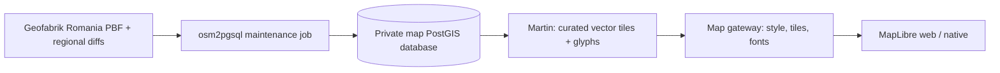

# Map Data

Independent OSM basemap infrastructure: a dedicated PostGIS database, an osm2pgsql import/update job, Flyway-managed tile functions, and read-only Martin serving. This stack does not connect to the Application API database, Kafka, or the realtime service. Valhalla, H3 reports, offline downloads, and elevation are outside its scope.

## Architecture and Ownership



- `compose.yaml` is a separate Compose project. Root Compose and the existing application database are unchanged.
- `importer/flex.lua` owns the OSM-to-feature mapping; `osm.features` stores selected display geometry in Web Mercator (EPSG:3857). Osm2pgsql maintains object identities and the separate `osm_middle` state needed for updates. Do not remove the middle tables or use `--drop`.
- `database/migrations/` contains this module's Flyway migrations, not the Application API's migrations. Apply future SQL changes with new versions. Initial extension/role setup runs once on a fresh database volume.
- `tiles.basemap(z, x, y)` produces an MVT layer named `features`, with `kind`, `class`, and optional `name` attributes. A GiST geometry index from osm2pgsql and zoom filtering limit each query to the tile's buffered envelope. MVT extent is 4096 with a 64-unit buffer to avoid clipped strokes at tile edges.
- `map_import` owns imports/migrations; `map_tiles` has read-only feature access and execution permission on the published function, not access to raw replication state. Database and Martin ports are not published to the host. Only the gateway is exposed, bound to loopback by default.
- `gateway/style.json` matches this small schema; it is not OpenMapTiles-compatible. Noto Sans glyphs are generated by Martin from a font packaged into its image. No external tile/font provider or sprites are needed for this style.

This is a first self-hosted basemap implementation, not a production-tuned replacement for a mature global map style. It includes roads, inland water, waterways, land cover, building footprints, place/road/POI labels, administrative boundary lines, and coastline lines. Sea polygon generation, rail/transit styling, detailed bridge/tunnel ordering, and pre-generalized low-zoom layers are not included. Coastline lines alone do not fill the Black Sea; that needs a processed coastline polygon dataset or a separate coastline-build step. Geometry selection uses display-oriented zoom thresholds, not a comprehensive mapping of every OSM tag.

## Prerequisites

Run Docker with Linux containers, Docker Compose v2 with `--wait` support, internet access for images/data, and SSD storage. A country import needs several GB of RAM plus significantly more disk space than the compressed PBF; start with at least 4 GB assigned to Docker and monitor actual usage. The 512 MB importer cache is not its total memory limit. Do not download the full planet for this stack.

Docker's engine was unavailable during implementation. Compose/style/contracts and Lua mapping tests can be checked without it, but image builds, the real PostGIS/Martin smoke test, full Romania import, live replication, and native rendering still need runtime verification. Do not switch a working deployment before those checks pass.

## Initial Romania Import

Run these commands from `services/map-data/`. Copy `.env.example` to `.env` and replace all three password placeholders with separate random values. Use URL-safe characters for `MAP_TILES_PASSWORD` because it is embedded in Martin's connection URL. The `.env` file is ignored; never commit it or print resolved Compose configuration containing its credentials.

```sh
docker compose --env-file .env up -d --wait map-db
docker compose --env-file .env --profile maintenance run --build --rm map-job download
docker compose --env-file .env --profile maintenance run --rm map-job import
docker compose --env-file .env --profile maintenance run --rm map-job replication-init
docker compose --env-file .env up --build -d --wait map-gateway
docker compose --env-file .env --profile maintenance run --rm map-job verify
```

The download uses Geofabrik's Romania extract and verifies its published MD5 checksum before promoting the partial file. This is an integrity check, not a cryptographic authenticity guarantee; transport uses HTTPS. The PBF remains in a persistent volume for checkpoint initialization. Do not replace it with a newer snapshot after import and use it to reset replication.

`import` performs one full regional import with `--create --slim`, bounded cache/concurrency settings, and sequential index construction. It refuses to overwrite an existing import. Flyway and Martin start only after the explicit import step; running the gateway against an empty database will fail rather than publish an empty-looking replacement map.

All maintenance operations take the same non-blocking volume-backed lock. This prevents overlapping jobs within this deployment, not independently configured writers on another host. Run only one writer deployment per database.

The HTTP interface is:

- `http://localhost:3001/style.json`: complete MapLibre style.
- `http://localhost:3001/tiles/basemap`: TileJSON metadata.
- `http://localhost:3001/tiles/basemap/{z}/{x}/{y}`: MVT bytes, server zoom levels 4-15.
- `http://localhost:3001/font/Noto%20Sans%20Regular/0-255`: example glyph range.
- `http://localhost:3001/health`: Martin liveness through the gateway; it does not prove that the imported data is current or complete.

MapLibre overzooms the z15 data at higher camera zooms instead of requesting country-scale downloads. OSM attribution is included in both the style and tile metadata. Observe OSM's ODbL and font license requirements when deploying or distributing derived data.

## Frontend Cutover

After import and verification, set this in the frontend's local environment and restart Expo:

```dotenv
EXPO_PUBLIC_MAP_STYLE_URL=http://localhost:3001/style.json
```

Use the host's LAN IP for physical phones and `10.0.2.2` for an Android emulator that accesses the host through that address. For LAN access set `MAP_BIND_ADDRESS=0.0.0.0`, allow only the necessary firewall traffic, and use the same accessible host in the style URL. The frontend resolves relative tile/glyph paths against this address, so it never sends them to Expo by mistake. Native cleartext HTTP policies may require local development configuration; use HTTPS for deployed services and native release builds.

Leave the frontend variable empty to keep the hosted prototype during rollout. It does not silently fail over to hosted tiles when a configured self-hosted endpoint is unavailable. The map gateway is public basemap infrastructure with wildcard CORS and no cookies; do not attach private user data, account endpoints, or database credentials to it. Put TLS, request limits, and monitoring in front of it for deployment.

## Weekly Incremental Updates

Use the **same regional replication feed as the PBF**. `replication-init` reads the original PBF headers, validates the configured feed, and preserves an existing complete checkpoint. The tool has separate state for feed URL, sequence, and timestamp in `osm_middle.osm2pgsql_properties`. Never manually advance these values or initialize against the newest feed sequence: that would skip changes.

```sh
docker compose --env-file .env --profile maintenance run --rm map-job update
docker compose --env-file .env --profile maintenance run --rm map-job status
```

Schedule `update` weekly with the deployment scheduler, cron, or Windows Task Scheduler, using the module as the working directory and the same Compose project/volume configuration. No OS task is installed automatically. This catches up through the missing daily regional diffs in bounded batches (100 MB target per batch), with osm2pgsql applying changes to existing rows. It is not a weekly full reimport. Do not feed unprocessed arbitrary planet diffs straight to append mode; the replication utility merges/simplifies the regional changes correctly.

Monitor exit codes and replication timestamp lag; a successful health check is not a freshness check. Geofabrik diffs have finite retention (roughly three months), so long outages may require a new full import in a separate staging stack. Other countries need compatible extracts and update feeds; combining datasets requires a planned merge/replication strategy, not switching feeds in-place.

Martin's memory tile cache is disabled and the gateway sends `Cache-Control: no-cache`, avoiding an unbounded stale cache after updates. An open MapLibre session can still retain tiles; reopen/reload the map to inspect fresh data. Add versioned URLs or explicit cache invalidation before enabling persistent/CDN caches. That performance work is separate from offline-pack support.

Imports and updates are not globally atomic across all osm2pgsql work. Do not serve during the initial import; for updates accept a short consistency window or use a maintenance/staging strategy. A failed update should be rerun after fixing the cause; the replication utility resumes from persisted state. A failed initial import or schema-changing flex edit needs a fresh staging project, not destructive commands against the live database. `docker compose down` preserves data; `down --volumes` destroys it and is not a normal maintenance operation.

## Verification

From the repository root, with frontend npm dependencies installed:

```sh
docker compose --env-file services/map-data/.env.example -f services/map-data/compose.yaml --profile maintenance config --quiet
node --test services/map-data/tests/contracts.test.mjs
node services/map-data/tests/smoke.mjs
```

The contract check validates the real style against the MapLibre specification and checks schema wiring. The smoke test needs Docker: it creates a uniquely named disposable project with random test credentials, imports the synthetic fixture, checks database permissions, decodes real tiles at different zooms, checks local glyph serving, applies create/modify/delete changes, and checks changed tile contents. It removes only its own project/volumes in cleanup. It does not validate Romania completeness or the real replication feed.

Lua classification tests also run inside the smoke test. Without Docker, run `lua5.4 services/map-data/tests/flex.test.lua services/map-data/importer/flex.lua` with a local Lua interpreter, or use `npx --yes --package=fengari-node-cli fengari` instead of `lua5.4` for a temporary JavaScript-hosted interpreter. Mock geometries test tag/zoom mapping, not osm2pgsql's actual polygon assembly; that requires the integration test.

After the full Romania import, inspect city presets and the country overview, inland water/buildings/labels, tile request bounds, query latency, database size, import/update runtime, and timestamp lag before cutover. Add operational budgets and low-zoom generalization based on those measurements. Valhalla still needs a separate OSM-to-routing-graph build/update pipeline.

References: [osm2pgsql flex output and replication](https://osm2pgsql.org/doc/manual.html), [Martin function sources](https://maplibre.org/martin/sources-pg-functions/), [Geofabrik Romania](https://download.geofabrik.de/europe/romania.html).